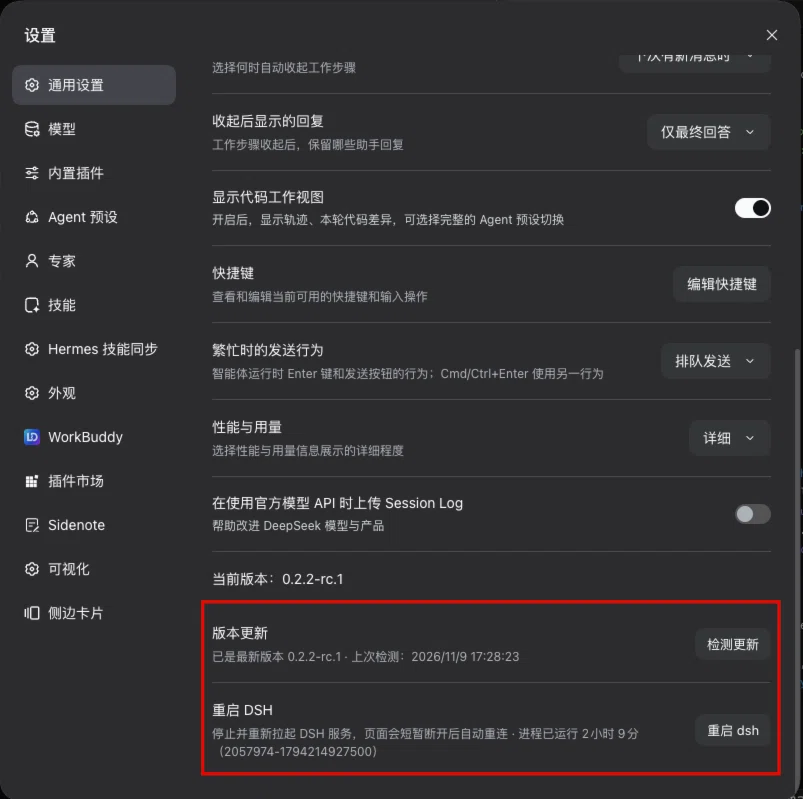

# dsh-tiedan-update

> 在 DSH 设置面板里检测新版本、一键升级、一键重启。
> Check for a new DSH release, upgrade in place, and restart — all from the Settings panel.

[](LICENSE)
[](https://github.com/deepseek-ai)

一个面向 [DeepSeek Harness](https://github.com/deepseek-ai)（以下简称 DSH）的 Cordis 插件（Host + Client 双半边）。
它在 DSH 的 **设置 → 通用** 分区里增加两行：

1. **版本更新** —— 点「检测更新」查询 npm 注册表，比对当前运行版本；有新版本时按钮变成「更新到 x.y.z」，
   点击即在后台执行安装，完成后提示重启生效。
2. **重启 DSH** —— 两段式确认后停止当前 DSH 进程，由 systemd（或重新拉起）拉起新进程，页面自动重连。

A Cordis bundle (Host + Client halves) for DeepSeek Harness. It adds two rows to the
**Settings → General** section: a version checker that queries the npm registry and
installs a newer DSH release in the background, and a two-step restart that hands the
process over to its supervisor so the page reconnects on its own.

---

## 目录 / Contents

- [截图 / Screenshot](#截图--screenshot)
- [功能 / Features](#功能--features)
- [优势 / Why](#优势--why)
- [安装 / Installation](#安装--installation)
- [使用 / Usage](#使用--usage)
- [实现逻辑 / How it works](#实现逻辑--how-it-works)
- [HTTP 接口 / HTTP API](#http-接口--http-api)
- [配置 / Configuration](#配置--configuration)
- [目录结构 / Repository layout](#目录结构--repository-layout)
- [排查 / Troubleshooting](#排查--troubleshooting)
- [许可 / License](#许可--license)

---

## 截图 / Screenshot

红框标出的两行就是本插件加进 **设置 → 通用** 分区的内容：

The two rows highlighted below are what this bundle adds to **Settings → General**:



---

## 功能 / Features

| 功能 | 说明 |
| --- | --- |
| **检测更新** | `POST /check` 读取 npm packument，取 `dist-tags.latest`，并与当前**正在运行**的版本做 semver 比较（含预发布版本）。 |
| **预发布版本可见** | 如果稳定通道没有更新、但预发布通道有，会单独标出「发现新版本 x.y.z（预发布）」，由你决定要不要装。 |
| **后台安装** | 安装是一个**后台任务**：接口立即返回任务描述，前端轮询 `/job` 拿实时输出，界面上有进度反馈。 |
| **流式输出** | 安装任务的 stdout/stderr 实时回填到界面的输出框，滚动保留最后 64 KiB。 |
| **重启 DSH** | 两段式确认（第一次变成「确认重启」，6 秒无操作自动取消），由 systemd 单元负责拉起新进程。 |
| **重启诊断** | 状态行实时显示进程已运行时长与进程标识；页面重连不会改变它们，**只有进程真的重启才会变**，因此可以用来区分「连接层抖动」与「服务重启」。 |
| **防双进程** | 每个进程最多接受一次重启请求；配置了 systemd 单元却拿不到 MainPID 时**直接拒绝**（503），绝不退回到「另起一个进程」，避免两个实例抢同一个端口。 |
| **认证准入** | 所有路由都经过 `ctx.connection.requestRejection()` 校验，只有带有效浏览器会话的请求才会被处理。 |
| **多语言** | 插件市场元数据内置 `zh` / `en` / `de` / `es` / `fr` / `ja` / `pt` / `ru` 八种语言。 |
| **零运行时依赖** | 插件自身没有任何 npm 依赖，配置校验是手写的 Standard Schema v1，因此以链接方式安装或打包安装行为完全一致。 |

---

## 优势 / Why

**相对「命令行里手动 `npm install -g`」：**

- **不用切窗口。** 更新与重启都在设置面板里点两下，版本号、上次检测时间、安装输出都在同一屏。
- **先看清再升级。** 检测只读注册表、不动本地文件；只有你点了「更新到 x.y.z」才会真正安装。
- **不会静默失败。** 安装任务失败会带上真实原因（退出码、被信号杀死、post-update 钩子失败）显示在界面上，而不是写进日志让你自己去翻。

**相对自己写脚本：**

- **不会把服务搞挂。** 「点两次就重启」这种朴素实现，很容易在重启窗口期拉起第二个 DSH 进程，两个进程抢同一个端口，表现出来就是一个无限重启的循环。这个插件在三个层面挡住了它：单进程单次重启、systemd 单元拿不到 MainPID 时拒绝执行、只有完全没有 systemd 托管时才走重新拉起分支。
- **区分「看起来断了」和「真的重启了」。** 隧道抖动、WebSocket 重建都会让页面弹「重新连接中」。`bootId` / `uptimeSeconds` / `restartRequested` 三个字段让你一眼判断到底是哪一种。
- **前缀自动推导。** 不填 `installPrefix` 时，插件从当前安装目录反推 npm 全局前缀，升级不会装到另一个前缀下面去。

---

## 安装 / Installation

### 环境要求 / Requirements

- DeepSeek Harness（开发与验证基于 `0.2.x` 系列）
- Node.js 18+
- `npm` 或 `pnpm` 之一（用于执行安装）
- Linux + systemd（可选；没有 systemd 时插件会退回到「停止进程后重新拉起」）

### 方式一：从源码仓库安装 / Install from this repository

```bash
git clone https://github.com/Hochan666/dsh-tiedan-update.git
cd dsh-tiedan-update
dsh plugin --profile web add "$PWD"
```

`dsh plugin` 会把剩余参数转发给 profile 目录下的包管理器，本地目录会被**链接**进 profile。

### 方式二：在 DSH 插件市场安装 / Install from the plugin market

本包已按 npm 包结构发布。安装后重启 DSH，在 **设置 → 插件市场** 中搜索 `dsh-tiedan-update` 即可。

### 方式三：插件管理器 / Via the plugin manager

```
plugin_manager install_bundle <本仓库的绝对路径>
```

### 卸载 / Uninstall

```bash
dsh plugin --profile web remove dsh-tiedan-update
# 或
plugin_manager remove_bundle dsh-tiedan-update
```

> **注意：** Host 模块只在 DSH 进程启动时加载，Client bundle 才能热更新。
> 改完 `index.js` 需要「卸载 + 安装」并重启 DSH；改完 `client.js` 只需要刷新浏览器。

---

## 使用 / Usage

1. 打开 **设置 → 通用**，找到 **版本更新** 一行。
2. 点 **检测更新**。界面会显示当前版本、最新版本与上次检测时间；有新版本时按钮变成 **更新到 x.y.z**。
3. 点 **更新到 x.y.z**。安装任务在后台运行，输出实时回填。完成后提示「重启 DSH 后生效」。
4. 在 **重启 DSH** 一行点 **重启 dsh**，再点一次 **确认重启**。进程退出，页面短暂断开后自动重连。

**典型场景**

| 场景 | 操作 |
| --- | --- |
| 日常升级 | 检测更新 → 更新到 x.y.z → 等输出结束 → 重启 DSH |
| 只看版本 | 检测更新，看一眼「已是最新版本 x.y.z」即可 |
| 装了预发布通道 | 检测更新后界面会标注「（预发布）」，确认后再点更新 |
| 只想重启 | 直接用「重启 DSH」这一行 |

---

## 实现逻辑 / How it works

### Host 半边（`index.js`）

Host 半边拥有全部**有副作用**的能力：读注册表、跑安装任务、终止/拉起进程。
**这里发生的一切都必须由浏览器显式请求才会触发。**

1. **路由注册**
   `ctx.inject(['webServer'], ...)` 拿到 `webServer` 后注册五条 `exact` 路由。每条路由进入业务逻辑前先调
   `ctx.get('connection').requestRejection(req)`：没有有效浏览器会话 Cookie 的请求一律被拒，公网隧道也无法绕过。

2. **版本比对**
   `compareVersions()` 是一份手写的 semver 比较器，**包含预发布版本**的规则：
   预发布版本排在同号正式版之前（`1.0.0-rc.1 < 1.0.0`），数字型预发布标识按数值比较，
   数字优先于非数字，标识逐段字典序比较。
   `readPackument()` 直接读注册表的 packument；作用域里的 `@` 保持字面量（镜像站会拒绝编码过的 `@`）。

3. **安装任务**
   `POST /install` 创建一个任务对象后**立即返回 202**，真正的 `npm install -g` 在后台异步执行：
   - 同一个进程内同时只允许一个安装任务在跑，重复请求返回 409；
   - 命令按 `packageManager` 选择 `npm install -g [--prefix …] <pkg>@<version>` 或 `pnpm add -g …`；
   - 安装输出边跑边收，保留最后 64 KiB；
   - 安装成功后可选地执行 `postUpdateCommand`（`sh -c`），钩子失败会把任务标记为 failed 并给出原因，**不会静默继续**。

4. **重启**
   这是本插件最需要小心的部分。逻辑分三层：
   - **单进程单次重启。** `restartRequested` 标志在进程内只允许一次重启；重启进行中再次点击返回 409。
   - **systemd 单元是进程的唯一所有者。** 配置了 `serviceUnit` 时，先用 `systemctl show -p MainPID --value` 取主进程号；
     取不到就返回 503 并**拒绝执行**，绝不改为重新拉起——因为在单元托管之外再拉起一个副本，就会出现两个 DSH 争抢同一个端口，那正是无限重启的真正来源。
   - **只有完全没有 systemd 托管（`serviceUnit` 为空）时**才走 `respawn` 分支：以 `detached: true` 重新执行自身，100 ms 后退出当前进程。

5. **响应先落地，进程随后退出**
   `POST /restart` 先把响应写回 socket（`sendJson` 的 `onFlushed` 回调），再延迟 250 ms 才开始真正终止进程。
   这样浏览器能收到明确的应答，而不是面对一个断掉的连接。

6. **可诊断的存活状态**
   `statusPayload()` 除了版本信息，还返回三个字段：
   - `bootId` —— `${process.pid}-${Date.now()}`，本进程的唯一身份，**页面重连不会改变它**；
   - `uptimeSeconds` —— 单调增长即为正常，归零才是真重启；
   - `restartRequested` —— 本进程是否已接受过一次重启。

### Client 半边（`client.js`）

注册在宿主的 `settings.general.item` slot 上，渲染两行设置。

- 组件自己 `useState` 管理状态，不依赖宿主传入的 props，因此宿主重构 props 也不会崩。
- 安装任务通过 `setInterval` 每秒轮询 `/job`；若发现宿主重启后不认识这个任务（返回空），就清空任务状态而不是无限轮询。
- 重启行的请求如果因为连接被切断而失败（`TypeError`），界面会把它当作**已发送**处理——因为宿主是先应答再退出的，连接断开恰恰说明指令已经到达。
- 样式是一段只引用 `--dsw-alias-*` 主题 token 的 CSS，明暗主题自动跟随宿主。

---

## HTTP 接口 / HTTP API

| 方法 | 路径 | 说明 |
| --- | --- | --- |
| `GET` | `/dsh-tiedan-update/status` | 当前版本、安装路径、已解析的 npm 前缀、上次检测结果、正在运行的安装任务、进程存活状态（`bootId` / `uptimeSeconds` / `restartRequested`）。 |
| `POST` | `/dsh-tiedan-update/check` | 读取注册表 packument，返回最新版本与是否可更新。注册表不可达时返回 502 与原因。 |
| `POST` | `/dsh-tiedan-update/install` | 启动一次后台安装任务，立即返回 202 与任务描述。已有任务在跑时返回 409。 |
| `GET` | `/dsh-tiedan-update/job?job=<id>` | 查询安装任务的状态与输出。 |
| `POST` | `/dsh-tiedan-update/restart` | 发送重启指令。响应先落地，进程随后退出。已在重启中返回 409；systemd 单元不可用返回 503。 |

---

## 配置 / Configuration

配置写在 profile 的 `cordis.patch.yml` 中该插件的 `config` 下：

```yaml
- insert:
    - id: dsh-tiedan-update
      name: 'dsh-tiedan-update'
      config:
        packageName: '@deepseek-ai/dsh'
        registry: 'https://registry.npmmirror.com'
        packageManager: 'npm'
        serviceUnit: 'dsh.service'
        postUpdateCommand: ''
```

| 字段 | 默认值 | 说明 |
| --- | --- | --- |
| `packageName` | `@deepseek-ai/dsh` | 提供 DSH 的 npm 包名。 |
| `registry` | `https://registry.npmmirror.com` | 查询与安装使用的注册表。可以换成官方源 `https://registry.npmjs.org`。 |
| `packageManager` | `npm` | 安装使用的包管理器（`npm` 或 `pnpm`）。 |
| `installPrefix` | 空 | npm 全局前缀；留空时从当前安装目录推导（形如 `…/lib/node_modules/…` 的布局）。 |
| `serviceUnit` | `dsh.service` | 管理 DSH 的 systemd 单元；**留空**则改为停止进程后重新拉起。 |
| `postUpdateCommand` | 空 | 安装成功后执行的 shell 命令。留空即不执行。 |
| `requestTimeoutMs` | `20000` | 注册表请求超时（毫秒）。 |
| `installTimeoutMs` | `900000` | 安装任务超时（毫秒，默认 15 分钟）。 |

实际执行的安装命令形如：

```
npm install -g --prefix <npm-prefix> @deepseek-ai/dsh@0.2.3
```

> 如果你给 DSH 打过本地补丁，`npm install -g` 会覆盖它。这种情况下把 `postUpdateCommand`
> 指向你的补丁重放脚本即可——该脚本失败时安装任务会明确报错，而不是假装成功。

---

## 目录结构 / Repository layout

```
dsh-tiedan-update/
├── index.js            # Host 半边：注册表查询、semver 比对、后台安装、重启决策
├── client.js           # Client 半边：设置面板里的两行（版本更新 / 重启）
├── cordis.patch.yml    # Loader patch：插入 Host 行与默认配置
├── locale/
│   ├── zh.json  en.json  de.json  es.json
│   ├── fr.json  ja.json  pt.json  ru.json
├── icon.svg            # 插件图标
├── docs/images/        # README 截图
├── README.md
├── LICENSE             # PolyForm Noncommercial 1.0.0
└── package.json
```

---

## 排查 / Troubleshooting

**页面反复显示「重新连接中」，但服务其实没重启？**

这是**连接层**在抖动（隧道会话重置、浏览器侧 WebSocket 重建），不是重启循环。
判断方法：

```bash
# 进程真重启了吗？（次数不涨 = 没重启）
systemctl show -p NRestarts -p ActiveEnterTimestamp dsh.service

# 有没有出现第二个 DSH 抢端口？（必须只有 1 个 node 进程、1 个监听者）
pgrep -af "bin/dsh --profile web" | grep "^[0-9]* node "
sudo ss -tlnp | grep 3080
```

同时看设置面板里的「进程已运行 X」——它连续观测**严格单调增长**就说明进程没重启。

**点击重启后没反应？**

- 检查 `serviceUnit` 配置的单元名是否正确：`systemctl status <unit>`。
- 如果单元存在但拿不到 MainPID，插件会返回 503 并拒绝执行——这是**故意的**：宁可不动，也不要拉起第二个实例抢端口。
- 如果你用的是非 systemd 部署，把 `serviceUnit` 置空，插件会走「停止进程后重新拉起」的分支。

**更新后行为没变化？**

更新只替换磁盘上的包，**当前运行的进程仍然使用旧代码**，必须重启才生效。

**安装失败？**

界面上的输出框里是真实的 npm 输出。常见原因：网络不可达、注册表源被限流、npm 全局目录没有写权限。

---

## 许可 / License

本项目采用 **[PolyForm Noncommercial License 1.0.0](LICENSE)**。

- ✅ 允许：个人使用、研究、实验、教学、非营利组织的使用。
- ❌ 不允许：任何商业用途，也不得将本软件用于任何预期产生商业收益的场景。
- ✅ 允许：修改、衍生作品、重新分发（须保留本许可与 `Required Notice`）。

**Required Notice: Copyright Hochan (https://github.com/Hochan666)**

本软件按「现状」提供，不附带任何明示或默示担保。作者不对使用本软件造成的任何损失承担责任。
如果你需要在商业场景中使用，请先通过
[Issues](https://github.com/Hochan666/dsh-tiedan-update/issues) 联系作者取得许可。

---

## 致谢 / Credits

- [DeepSeek Harness](https://github.com/deepseek-ai) —— 插件运行时、slot 机制与连接认证服务。
